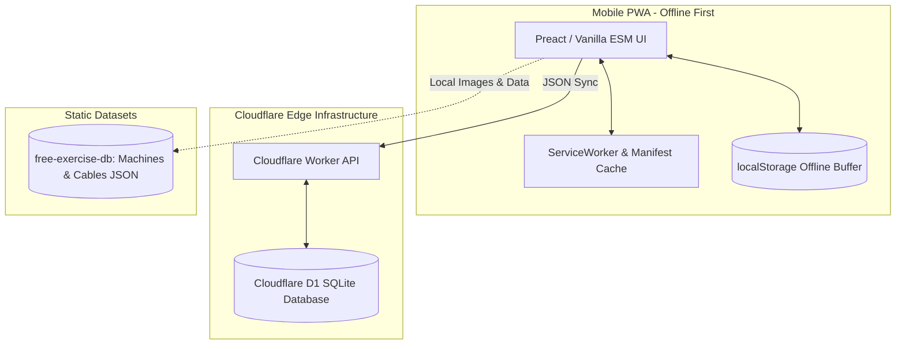

# 🏋️ Minimal Gym PWA: Architecture & Execution Plan

> **Design Philosophy**: Minimalist, high-contrast, brutalist aesthetic (matching `v.yahya.click`). Zero emojis, zero cartoon gamification, zero typing fatigue. Engineered for instant logging on mobile when exhausted.

---

## 1. System Architecture



---

## 2. Technology Stack

* **Frontend**: Vanilla JavaScript or Preact (via ESM / zero build-tool bloat).
* **Styling**: Vanilla CSS. Deep dark palette (`#090a0f`, `#11131a`), monospace/sans typography (`JetBrains Mono` / `Inter`), crisp borders (`#1e2230`), cyan accent (`#38bdf8`).
* **PWA Engine**: Service Worker (`sw.js`) + `manifest.json` for standalone Android/iOS home screen installation.
* **Exercise Dataset**: Curated subset of `yuhonas/free-exercise-db` strictly filtered for `machine` and `cable` equipment.
* **Backend & Persistence**: Cloudflare Workers + Cloudflare D1 (Serverless SQLite).
* **Authentication**: Minimal username + passphrase hash (HMAC-SHA256). No emails, no verification tokens.

---

## 3. Database Schema (Cloudflare D1)

```sql
-- Users (No email, no verification)
CREATE TABLE users (
    id TEXT PRIMARY KEY,
    username TEXT UNIQUE NOT NULL COLLATE NOCASE,
    password_hash TEXT NOT NULL,
    salt TEXT NOT NULL,
    created_at TIMESTAMP DEFAULT CURRENT_TIMESTAMP
);

-- User Routines / Daily Splits
CREATE TABLE user_routines (
    id TEXT PRIMARY KEY,
    user_id TEXT NOT NULL,
    day_name TEXT NOT NULL, -- 'PUSH', 'PULL', 'LEGS' or 'MON', 'TUE', etc.
    exercise_id TEXT NOT NULL,
    sort_order INTEGER DEFAULT 0,
    FOREIGN KEY(user_id) REFERENCES users(id)
);

-- Workout Logs (Cold, Raw Metrics)
CREATE TABLE workout_logs (
    id TEXT PRIMARY KEY,
    user_id TEXT NOT NULL,
    exercise_id TEXT NOT NULL,
    weight_kg REAL NOT NULL,
    reps INTEGER NOT NULL,
    set_number INTEGER DEFAULT 1,
    logged_at TIMESTAMP DEFAULT CURRENT_TIMESTAMP,
    FOREIGN KEY(user_id) REFERENCES users(id)
);

CREATE INDEX idx_logs_user_date ON workout_logs(user_id, logged_at);
```

---

## 4. User Experience & Workflows

### A. Frictionless Authentication
1. Enter `[ username ]` and `[ passphrase ]`.
2. If username does not exist $\rightarrow$ registers user instantly.
3. If username exists $\rightarrow$ validates against D1 and loads workout history.

### B. Daily Split View
* Top horizontal split bar: `[ DAY 1: PUSH ]` `[ DAY 2: PULL ]` `[ DAY 3: LEGS ]` `[ ALL MACHINES ]`.
* Only shows the 4–6 machines scheduled for that specific session.
* Each card shows:
  * Crisp high-contrast photo/diagram of the gym machine.
  * Standard machine name (e.g. `SEATED CHEST PRESS`).
  * Target muscle group (e.g. `PECTORALS // TRICEPS`).
  * Previous best performance: `LAST: 55 KG x 10 REPS`.

### C. Exhaustion-Proof Logging (Tap Only, No Typing)
* Tapping a machine card slides open the **Quick-Log Drawer**:
  * Weight Stepper: `[ - 5 ] [ - 2.5 ] [  55.0 KG  ] [ + 2.5 ] [ + 5 ]`
  * Reps Stepper:   `[ - 1 ] [  10 REPS  ] [ + 1 ]`
  * Button: **`[ LOG SET ]`** (Large, full-width, instant feedback).
* Immediate local state update $\rightarrow$ async background sync to Cloudflare D1.

---

## 5. Implementation Roadmap

1. **Phase 1: Dataset Extraction**
   * Filter `free-exercise-db` to extract machine/cable equipment and images.
   * Normalize exercise records into a compact static JSON bundle (~150 KB).

2. **Phase 2: Cloudflare Edge Backend**
   * Create Cloudflare D1 instance.
   * Write lightweight Worker router (`/api/auth`, `/api/routines`, `/api/logs`).

3. **Phase 3: Frontend PWA Core**
   * Implement UI using the Vault design tokens.
   * Wire offline caching via `localStorage` and Service Worker.

4. **Phase 4: Routine Builder & History**
   * Interface to pick which machines belong to which day.
   * History view showing date-by-date progressive overload.
